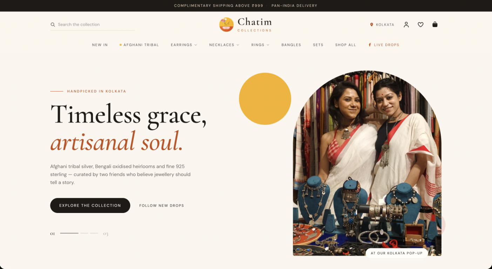

# Chatim Collections – Full-stack Jewellery Store

A production-style e-commerce site for **Chatim Collections**, a handcrafted and imitation jewellery
boutique in Purbachal, Kolkata. The catalogue (≈400 pieces) and homepage reels were imported from the
brand's Instagram account.



## Stack
| Layer | Tech |
|---|---|
| Frontend | React 19, React Router 7, TanStack Query, Zustand, Tailwind CSS 3, Vite, Font Awesome |
| Backend | Node.js 22 + Express 5, Zod validation, JWT (httpOnly cookie) auth, Helmet (CSP), compression, rate limiting, Multer uploads |
| Database | SQLite via Node’s built-in `node:sqlite` (no native build needed) |
| Hosting | Single Node process serves the API + built SPA; exposed with a Cloudflare quick tunnel |

## Features
**Storefront**
- Rotating promo bar, hero carousel, shop-by-category / collection tiles and customer testimonials.
- Homepage **video reels** taken from Instagram (with poster frames).
- Live search suggestions; category & collection browsing.
- Filter sidebar (category, collection, price, rating, in stock, new arrivals) with URL-synced state, sorting and pagination.
- Quick-view modal; product pages with image gallery + hover-zoom, stock indicators, PIN-code delivery check and related products.
- Reviews with rating breakdown and verified-buyer badges (signed-in customers can write reviews).
- Wishlist and cart persisted in the browser; the wishlist syncs to the account when signed in.
- Slide-over cart with free-shipping progress bar.
- **Price on request:** imported Instagram pieces have no price, so they show “Ask for price” and open a
  pre-filled **WhatsApp** message instead of adding to the cart.
- **Inquiry / stylist modal:** price enquiries and video-call bookings, saved as leads for the admin.
- Newsletter sign-up, Help/FAQ page (delivery, COD, exchange, jewellery care, store visits), Terms page and 404 page.
- SEO basics: meta description and Open Graph tags.

**Checkout & orders**
- Server-side re-pricing: the client never sets prices.
- Coupon engine (`CHATIM15`, `WELCOME100`, `PUJO25`); standard/express shipping; gift wrap.
- UPI/Card/COD. Online payments are **simulated**: no card data is collected.
- Stock reserved inside a database transaction; order confirmation page.
- Order tracking by order number + email; customers can cancel their own orders.

**Accounts**
- Register / sign in / sign out, profile & password change, order history with status timeline.

**Admin (`/admin`)**
- **Dashboard:** KPIs, revenue chart, category mix, top products, low-stock alerts.
- **Products:** CRUD with image upload or URL, quick stock adjust.
- **Orders:** fulfilment workflow, payment status, timeline notes, CSV export.
- **Customers**, **leads/inquiries** (with status), **newsletter subscribers** and a **coupon manager**.

**Security**
- Passwords hashed with bcrypt; JWT in an httpOnly cookie; Zod validation on every input.
- Helmet with a Content-Security-Policy; rate limits on auth and public forms; 200 KB JSON body limit.
- Secrets generated into a git-ignored `.env` on first run.

## Project layout
```
src/                 React app (pages/, pages/admin/, components/, store.js, lib/api.js)
server/              Express API (index.js, routes/api.js, routes/admin.js, db.js, seed.js)
server/data/         instagram-products.json – catalogue imported from Instagram (used by the seed)
public/media/        product photos, reels and homepage imagery served at /media
chatim-import/       local Instagram import tools + raw downloads (git-ignored, not needed to run the site)
```

## Run it
```bash
npm install            # once
npm run build          # build the React app into ~/.chatim-collections/dist
npm start              # http://localhost:8080 (API + site)
npm run tunnel         # public https://*.trycloudflare.com URL (needs cloudflared; uses HTTP/2 since QUIC is often blocked on corporate networks)
```
If the tunnel exits within seconds with "connection with edge closed", the nearest Cloudflare edge is rejecting the connection; use `npm run tunnel:us` to connect via the US edge instead.

Development with hot reload: `npm run dev` (Vite on :5173 proxying the API on :8080).

## Admin login
On first start the server creates `.env` with a random `JWT_SECRET` and admin credentials
(`ADMIN_EMAIL` / `ADMIN_PASSWORD`). Open `.env` to see them, change them there if you like,
and restart – the admin account is updated on every start.

## Data
The SQLite database lives in `~/.chatim-collections/` (outside OneDrive – cloud sync breaks SQLite
file locking). Override with `DATA_DIR=/some/path` in `.env` (and `BUILD_DIR` for the built frontend, which also lives outside OneDrive because sync renames folders mid-build). Uploaded product images go to
`<DATA_DIR>/uploads`. Reset the catalogue + demo orders with `npm run seed` (keeps the admin).

## Notes
- The Cloudflare quick-tunnel URL changes each time the tunnel restarts and only works while this
  machine is awake with both `npm start` and `npm run tunnel` running. For a permanent URL, use a
  named Cloudflare tunnel or deploy to a host such as Render/Fly.io/Railway.
- If `npm install` fails behind a corporate proxy with `UNABLE_TO_GET_ISSUER_CERT_LOCALLY`, export the
  macOS keychain roots and point npm at them:
  `security find-certificate -a -p /Library/Keychains/System.keychain /System/Library/Keychains/SystemRootCertificates.keychain > ~/corp-ca.pem && npm config set cafile ~/corp-ca.pem`

## Future plans – taking the site live
The site works end to end, but several parts are demo-grade. Roughly in priority order:

### 1. Must-have before accepting real orders
- **Real payments:** integrate an Indian payment gateway (Razorpay, Cashfree or PhonePe PG) for UPI/cards/net-banking.
  Confirm payments via signed server-side webhooks, never the browser.
- **Prices for the imported catalogue:** the ~400 Instagram pieces are “price on request”. Add prices, stock and
  materials in the admin so they can be bought online. Remove sold-out or duplicate pieces.
- **Hosting & domain:**
  - Buy a domain (e.g. `chatimcollections.in`) and deploy to an always-on host (Render, Railway, Fly.io or a small VPS) with HTTPS.
  - Replace the Cloudflare quick tunnel, which depends on this laptop being awake.
- **Production database:** move from SQLite to managed PostgreSQL, or keep SQLite on a persistent volume with
  Litestream backups. Add automated daily backups and a tested restore.
- **Image storage & CDN:**
  - Move `public/media` and admin uploads to object storage (Cloudflare R2, S3 or Cloudinary) behind a CDN.
  - Serve WebP/AVIF with responsive sizes; this also keeps the git repo small.
- **Legal & compliance (India):**
  - Add Privacy Policy, Refund/Cancellation, Shipping and Contact pages; payment gateways require these.
  - Collect cookie/data consent as required by the DPDP Act 2023.
  - Show GSTIN and generate GST-compliant invoices once registered.
- **Transactional email/SMS/WhatsApp:**
  - Send order confirmation, shipping and cancellation messages (e.g. Resend/SES for email, WhatsApp Business API or MSG91 for SMS/OTP).
  - Add **forgot-password / reset** and email verification.
- **Security hardening:**
  - Store secrets in the host's secret manager, not `.env`.
  - Add a strong admin password and 2FA, CSRF protection for cookie-authenticated writes, and dependency audits (`npm audit`, Dependabot).
  - Add error monitoring (Sentry) and uptime checks.

### 2. Operations
- **Shipping integration:**
  - Integrate Shiprocket/Delhivery for live PIN-code serviceability, rates, label generation and tracking numbers on the order page.
  - Add COD verification to reduce returns-to-origin.
- **Inventory:** stock history, a variant/size model, low-stock email alerts, and bulk CSV import/export for products.
- **Returns & exchanges workflow** in the customer account and admin, matching the 48-hour defective-item policy.
- **Admin roles** (owner vs. staff) and an audit log of admin actions.

### 3. Growth & marketing
- **SEO:**
  - Server-side rendering or pre-rendering (e.g. Vite SSR/React Router framework mode) so product pages are indexable.
  - Add `sitemap.xml`, `robots.txt`, product structured data (JSON-LD), canonical URLs and per-product Open Graph images.
- **Analytics:** GA4 or Plausible, with conversion tracking for checkout and WhatsApp enquiries.
- **Social commerce:**
  - Sync the catalogue to Meta Commerce (Instagram/Facebook Shop) and Google Merchant Center.
  - Automate importing new Instagram posts and reels (the `chatim-import` tools are a manual starting point).
- **Retention:** abandoned-cart reminders, festival campaigns (Pujo, Diwali) via the coupon engine, a loyalty/referral programme, and back-in-stock alerts.
- **Content:** a lookbook/blog, styling guides and customer photo reviews.

### 4. Quality & engineering
- Automated tests: API tests for pricing, coupons, stock and orders, plus Playwright end-to-end tests for checkout.
- GitHub Actions CI to lint, test and build on every push, with automatic deploys from `main`.
- Accessibility audit (WCAG 2.1 AA) and Lighthouse performance budgets for mobile, where most customers shop.
- Optional PWA (installable, offline product browsing) and Hindi/Bengali localisation.

## License
The source code is released under the [MIT License](LICENSE).
The Chatim Collections name and logo, and all photos and videos in `public/media/` and `screenshots/`,
are © Chatim Collections and are **not** covered by the MIT License. They may not be reused without permission.